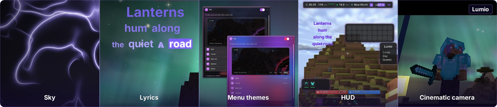
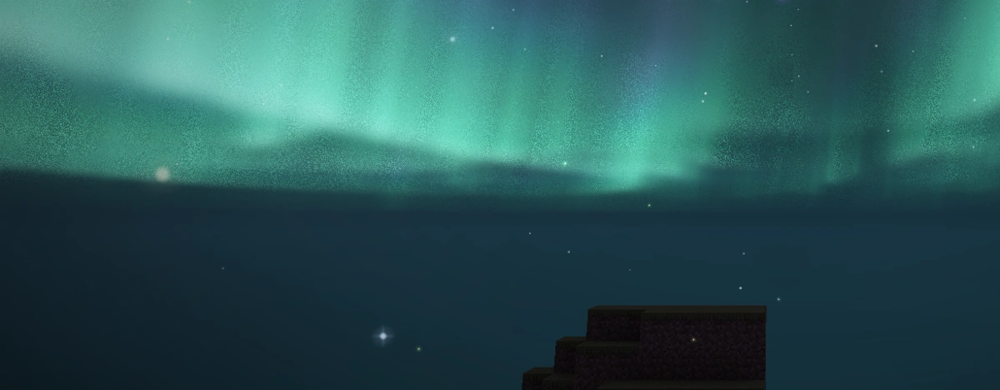
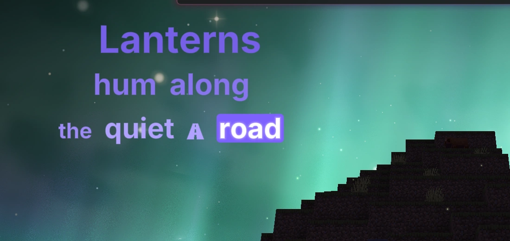
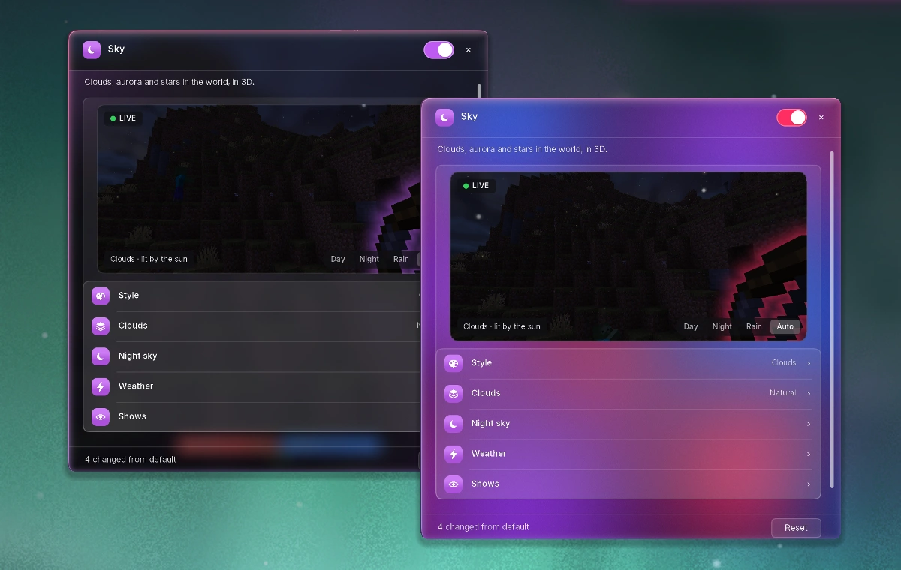
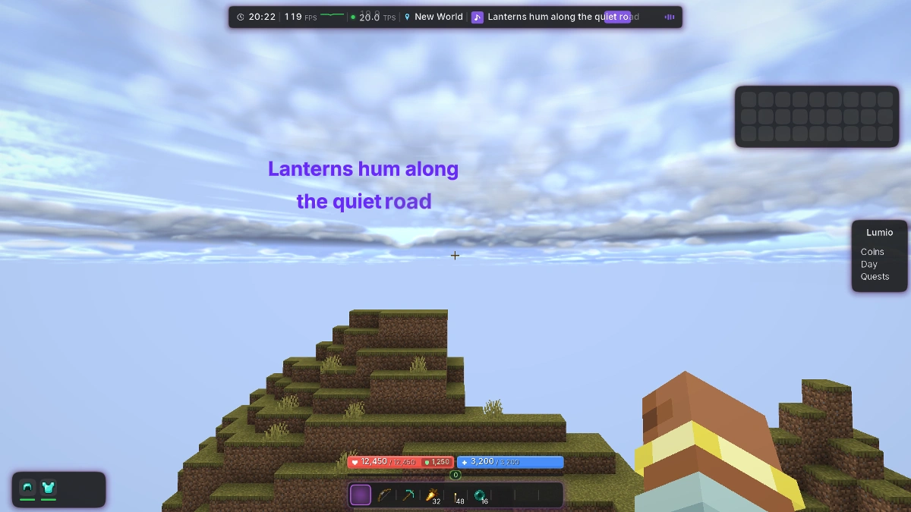
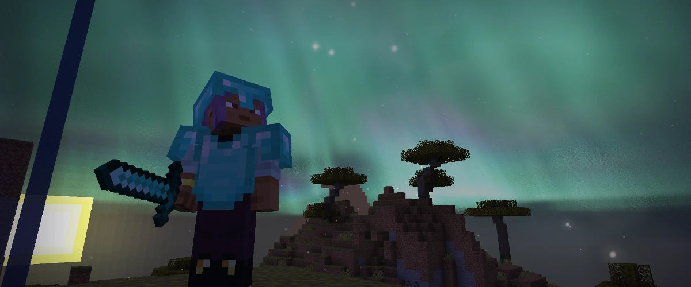
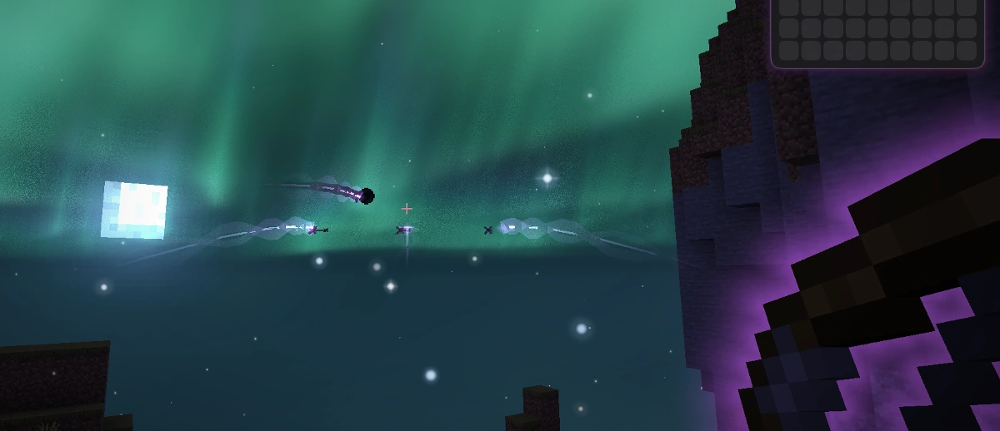
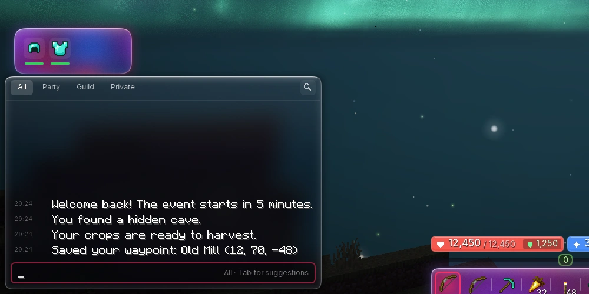

# Lumio

A calm, good-looking Minecraft: sky, music with lyrics, menus and HUD in one client-side mod.

**[Download from GitHub Releases](https://github.com/tim1337xd/Lumio/releases)** · [SkyBlock add-on](https://github.com/tim1337xd/Lumio-SkyBlock) · [Changelog](CHANGELOG.md)

<picture><source media="(prefers-color-scheme: light)" srcset="docs/readme/divider-light.png"></picture>

## Install

1. Install [Fabric Loader](https://fabricmc.net/use/) and [Fabric API](https://github.com/FabricMC/fabric-api/releases) for Minecraft 26.2 or 26.3 (Java 25).
   On Minecraft 26.3, also add `-XX:StackShadowPages=32` to the Java arguments in your launcher: Minecraft 26.3 itself can crash while starting on some PCs without it, also without Lumio.
2. Put the Lumio jar for your Minecraft version into your `mods` folder.
3. Start the game: a short setup opens. Later, open Lumio with `/lumio`.

Coming from Beta 1? Replace the old jar by hand once; from Beta 2 on, Lumio tells you about new versions itself.

<picture><source media="(prefers-color-scheme: light)" srcset="docs/readme/divider-light.png"></picture>

## Features

<b>Sky</b> · styles, clouds, aurora, stars

- Sky styles, among them Molten: thin glowing lines that flow slowly across a dark sky.
- 3D clouds in three layers, lit by the sun and turning stormy with the weather.
- Aurora, calm stars and shooting stars at night.
- Auto quality picks what your graphics card handles, so weak laptops stay smooth.

<b>Music and lyrics</b> · now playing, lyrics in the world

- The song with its cover in the info bar, a small player or a window (Cider, Spotify, Windows media).
- Live lyrics word by word, in the info bar and in the world.
- In the world as a glowing line or as cut-out words, placed in open sky where you look.
- The sung word glows, or the whole text; ad-libs stand beside the line, never over it.

<b>Menu and themes</b> · Glass, Dark, Light, Colored

- One settings window with search, a top bar and a way back.
- Themes Glass, Dark, Light and Colored, which can follow the song's colors.
- The game's own screens in the same look: buttons, sliders and lists.

<b>HUD</b> · editor, status bars, info bar

- Hotbar, status bars, boss bars, armor, scoreboard and player list in one style.
- An info bar with time, frames, ping, place and the song.
- A HUD editor: move, resize and snap everything by drag and drop.
- Elements step back while a menu is open.

<b>Cinematic camera</b> · a music video of your world

- Calm camera shots of your world while you are away from the keys.
- The lyrics of the song placed in each shot.
- Letterbox, slow moves and soft cuts.

<b>World effects</b> · trails, glow, held item, camera

- Trails behind arrows and ender pearls, and a glow around the held item.
- Size, place and swing of the item in your hand.
- An outline or glow on the block you look at, fireflies and wet ground in the rain.
- Full bright and less fog, fire and clutter on screen.

<b>Chat, waypoints and keys</b> · tabs, routes, one key per command

- A movable chat with tabs, Copy and Reply; the game's messages stay as they are.
- Waypoints in groups and routes, with beams, labels and a map; imports from Skyblocker, SkyHanni, ColeWeight and Skytils.
- Keys for chat commands and key combinations of up to three keys.
- Configs to share, and presets to start from.

<picture><source media="(prefers-color-scheme: light)" srcset="docs/readme/divider-light.png"></picture>

## Fair play

Lumio only changes how the game looks and shows what you can already see. It never plays for you: no automatic clicks, movement, item
use or commands. It sends nothing on its own; a command key or a chat tab sends only the one command you would type, and the info bar
asks for your ping with the game's own request. Nothing hidden is shown, such as players or blocks behind walls.

<picture><source media="(prefers-color-scheme: light)" srcset="docs/readme/divider-light.png"></picture>

## Questions

<b>Does it work with Sodium and Iris?</b>

Sodium: yes, Lumio is played with Sodium every day, and its video settings open from Lumio's options. Iris has not been tested yet; tell us
how it goes.

<b>Is it allowed on Hypixel?</b>

Lumio keeps to Hypixel's rules on allowed modifications: client-side, visual, no automation. Hypixel
does not approve any mod, so you use every modification at your own risk.

<b>Minecraft 26.3 crashes while starting</b>

That is the game, not Lumio (`EXCEPTION_ACCESS_VIOLATION`). The Java option `-XX:StackShadowPages=32` avoids it; some launchers, such as
Prism, already add it.

**Updates:** Lumio asks GitHub once per start whether a newer version exists; nothing is downloaded without a click.

<picture><source media="(prefers-color-scheme: light)" srcset="docs/readme/divider-light.png"></picture>

[Credits](CREDITS.md) · [GPL-3.0](LICENSE) · [Report a bug](https://github.com/tim1337xd/Lumio/issues) · Not affiliated with Mojang, Microsoft or Hypixel.
