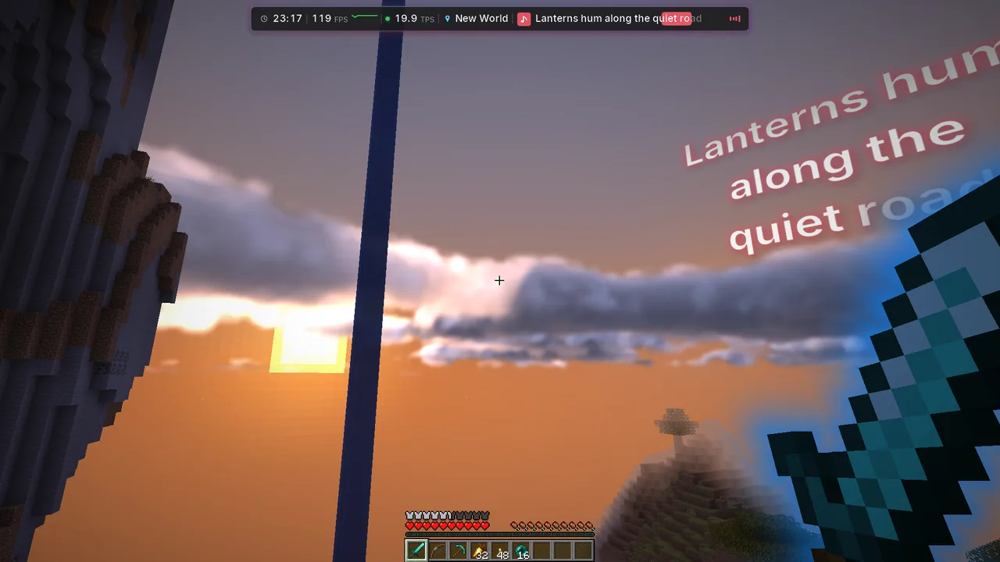
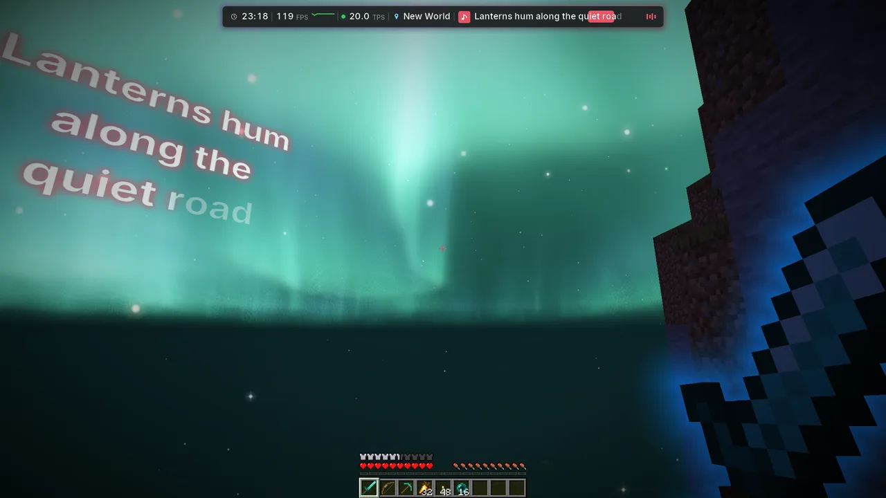
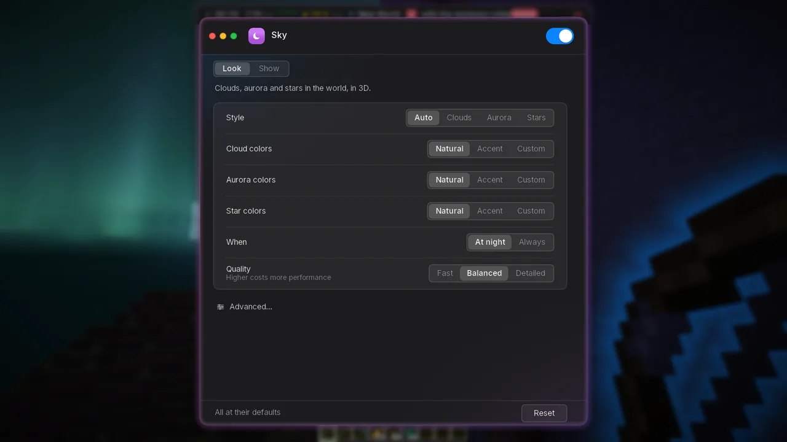
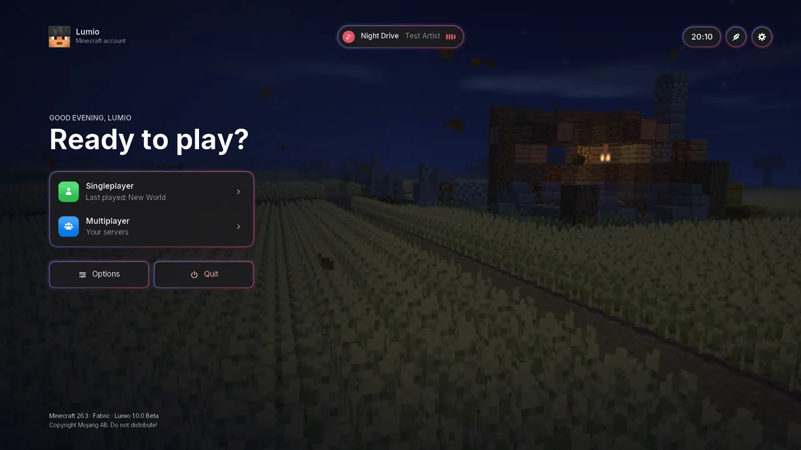

# Lumio

A modern, calm look for Minecraft: 3D skies, a redesigned HUD and menus, and music with live lyrics.

**Version 1.0.0 Beta.** Things may still change. [Feedback is welcome](https://github.com/tim1337xd/Lumio/issues).

## Features

**World**
- **Sky**: 3D clouds with light and shadow in a clear, cloudy or stormy look, aurora and shooting stars, and lightning with rain or always.
- **Ambience**: fireflies at night, rain with wet ground and puddles.
- **Trails**: silk, stardust, comet and more behind arrows and ender pearls.
- **Radiance**: a glow or an echo trail around the held item and your hands.
- **Held item**: size, position and swing speed of the item in your hand.
- **Block overlay**: an outline, glow or shader on the block you look at.
- **Walk effects**: light waves, rings or sparks where you walk.

**Interface**
- **Themes**: Glass, Dark, Light and Colored, which can follow the song's colors.
- **HUD**: hotbar, status bars, info bar, boss bars, armor, scoreboard and player list.
- **HUD editor**: move, resize and arrange everything by drag and drop.
- **Chat**: a movable panel with smooth scrolling, tabs, Copy and Reply.
- **Menus**: a living main menu, a settings window with search, one loading screen.
- **Tooltips**: their own frame; the game's text stays as it is.

**Music**
- **Now playing**: the song with its cover in the info bar, a small player or a window.
- **Live lyrics**: in the info bar, the players and the world, word by word.
- **Cinematic camera**: a calm music video of your world while you are away.
- Works with Cider (Apple Music), Spotify and the Windows media controls.

**More**
- Keybinds for commands, every key of Lumio and its add-ons in one list, shared configs, and two presets to start from (SkyBlock and Vanilla).
- Notifications, borderless fullscreen, no cursor reset between menus.
- Server resource packs that load only once.

## Installation

You need:
- Minecraft **26.2** or **26.3**
- [Fabric Loader](https://fabricmc.net/use/) 0.20.1 or newer
- [Fabric API](https://modrinth.com/mod/fabric-api)
- Java 25

Download the jar for your Minecraft version from the [releases page](https://github.com/tim1337xd/Lumio/releases):

| Minecraft | Jar |
| --- | --- |
| 26.2 | `lumio-1.0.0-beta.1+mc26.2.jar` |
| 26.3 | `lumio-1.0.0-beta.1+mc26.3.jar` |

Put it and Fabric API into your `mods` folder and start the game. A short setup opens on the first start. Open the settings any time with `/lumio`.

Lumio is client-side only. It works on any server.

## Add-ons

Lumio has an API for add-ons (see [api/API.md](api/API.md)).

- [Lumio: Hypixel SkyBlock](https://github.com/tim1337xd/Lumio-SkyBlock): panels, trackers and helpers for SkyBlock. It needs Lumio.

## Known issues

- Minecraft 26.3 can crash while starting (`EXCEPTION_ACCESS_VIOLATION`). This is the game, not Lumio. The Java option
  `-XX:StackShadowPages=32` avoids it. Some launchers, such as Prism, already add it.

## Privacy

Lyrics and covers come from online services while those features are on. [CREDITS.md](CREDITS.md) lists each one and what it receives.
Lumio never reads your Minecraft session and never sends your account anywhere. Shared configs never contain your tokens.

## Using it on Hypixel

Everything is client-side and visual. Lumio sends nothing of its own, except the game's own ping request for the info bar's ping.
Keybinds send one command per press, as if you typed it. Clicking a chat tab on Hypixel switches the channel with /chat, as if you typed it.
There is no automation.

Hypixel does not approve any mod. You use every modification at your own risk.

## Credits and license

See [CREDITS.md](CREDITS.md) for credits and online services, and [CHANGELOG.md](CHANGELOG.md) for changes.

Lumio is licensed under the [GPL-3.0](LICENSE). The bundled fonts Inter, Kalam and Poppins are under the SIL Open Font License 1.1.

Lumio is not affiliated with Mojang, Microsoft or Hypixel.
